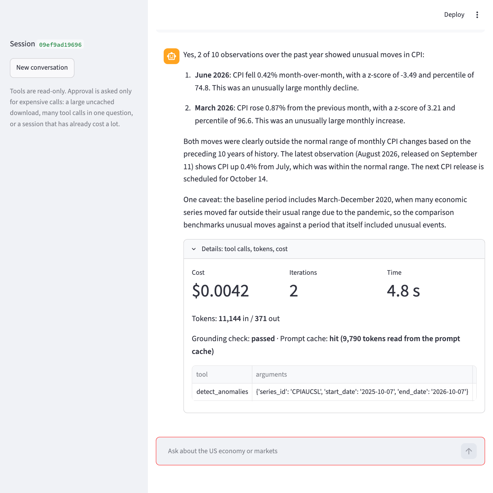
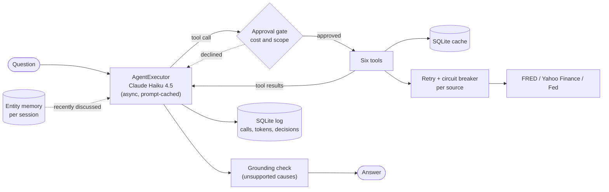

# Economic Pulse Agent

Economic Pulse Agent answers questions about US macro data and markets in plain language. You ask "What is the current unemployment rate?" or "Has anything unusual happened in CPI over the past year?", and a Claude Haiku 4.5 agent decides which tools to call, fetches the data from FRED and Yahoo Finance, and writes the answer from what came back.

Two rules shape it. The model never does the arithmetic or decides what counts as unusual: direction, percentage changes, year-over-year inflation and anomaly scores are computed in Python and quoted. And any cause the model offers has to appear in a tool result or carry the label "(not verified by my data)". A rule-based check enforces that after every answer.

## Example runs

Three real runs from 2026-10-07 with `claude-haiku-4-5`, copied without edits. I checked every number against FRED with a script that shares no code with the project ([`docs/verify_examples.py`](docs/verify_examples.py)). I replaced one run of example 3 because its summary called August 2025 the peak of core inflation when January 2025 was higher. The figures in that run were right and the sentence was not, which is the kind of slip the [known limitations](#known-limitations) describe. Costs are with a warm prompt cache. All seven questions from my last full run are in [`economic_pulse_agent/examples.txt`](economic_pulse_agent/examples.txt).

### 1. A simple question: freshness and the next release

> **You:** What is the current unemployment rate?

`get_economic_series(UNRATE, 2026-08-01 to 2026-10-07)` · 2 iterations · 10,960 tokens in / 176 out · $0.0030

> The current unemployment rate is **4.2%** as of September 2026 (published October 2, 2026). This represents an increase of 0.1 percentage points from August's 4.1%.
>
> The next employment report will be released on November 6, 2026.

The September and August values, the October 2 publication date and the November 6 next release all match FRED. The agent says which period the number describes and when it came out, because FRED dates name the period and not the release.

### 2. An "is it unusual?" question: statistics the model does not decide

> **You:** Has anything unusual happened in CPI over the past year?

`detect_anomalies(CPIAUCSL, 2025-10-07 to 2026-10-07)` · 2 iterations · 11,143 tokens in / 374 out · $0.0042

> Over the past year, 2 of 10 CPI observations were unusual:
>
> **June 2026**: CPI fell 0.42% month-over-month, a notably large decline (z = –3.49, 74.8th percentile). This was the biggest drop relative to what's typical for CPI month-to-month changes.
>
> **March 2026**: CPI rose 0.87% month-over-month, an unusually large jump (z = 3.21, 96.6th percentile), among the largest monthly increases in the past decade.
>
> The most recent observation (August 2026, published September 11) showed CPI up 0.4% from the previous month, which was within normal range. The next CPI release is scheduled for October 14.
>
> These moves suggest there was some volatility in price pressures in the first half of 2026, with a sharp acceleration in March followed by moderation by June, though neither move was truly extreme in absolute terms—they were just notably larger than CPI's typical month-to-month swings over the past decade.

Python decides what is unusual. Each month's change is scored against the previous ten years of changes (median and MAD, flagged at |z| of 3 or more) and the tool returns "2 of 10". My own recomputation gives the same two flags with the same z-scores, percentiles, changes and release dates. The answer invents no cause. It does explain the 74.8th percentile next to a z of -3.49 poorly: a fall in a series that usually rises is far from its usual change but only mid-sized in absolute terms.

### 3. A two-turn conversation: session memory

> **You:** What was the unemployment rate between January 2025 and August 2026?

`get_economic_series(UNRATE, 2025-01-01 to 2026-08-31)` · 2 iterations · 11,301 tokens in / 310 out · $0.0040

> The unemployment rate between January 2025 and August 2026 rose gradually from 4.0% to 4.1%, an increase of 0.1 percentage points. Here are the monthly values:
>
> **January 2025 – August 2026 Unemployment Rate:**
> - Started at **4.0%** (January 2025)
> - Peaked at **4.5%** (November 2025)
> - Ended at **4.1%** (August 2026)
>
> The rate climbed through the first half of 2025, reaching its high of 4.5% in November, then gradually declined through early 2026 before stabilizing around 4.1-4.2% from mid-2026 onward.
>
> The data was released on September 4, 2026. The next unemployment release is scheduled for November 6, 2026.

> **You:** And core CPI over the same period?

`get_economic_series(CPILFESL, 2025-01-01 to 2026-08-31)` · 2 iterations · 12,854 tokens in / 319 out · $0.0056

> Core CPI (excluding food and energy) rose from 324.64 in January 2025 to 337.77 in August 2026, up 4.04%. Year-over-year inflation declined significantly over the period, falling from 3.28% in January 2025 to 2.45% in August 2026.
>
> **Key pattern:** Core inflation peaked at 3.28% in early 2025, then generally trended down through spring 2025, hitting a low of 2.77% in May. It rebounded mid-year (reaching 3.11% in August 2025) before resuming its decline through early 2026. The latest reading of 2.45% (August 2026) continues that downward momentum.
>
> The August 2026 data was released on September 11, 2026. The next CPI release is scheduled for October 14, 2026.

The follow-up never said "2025 to 2026". A short "Recently discussed" line in the prompt gave the agent the first window, and it asked for exactly the same dates. The unemployment levels, the November 2025 peak, the index values, the 4.04% change, the year-over-year rates (3.28, 2.77, 3.11, 2.45) and all three release dates match FRED.

## The Streamlit app



The app is a chat box over the same agent. This screenshot is a separate run of the question from example 2. Under each answer, a details panel shows the cost, the number of model calls, the time, the tokens, the tool calls with their arguments, whether the grounding check passed and whether the prompt cache was hit. When a call would be expensive, the app asks with Approve and Decline buttons before running it. It listens on localhost only.

## Architecture



LangChain's `AgentExecutor` runs the loop: the model picks a tool, the tool runs, the result goes back, and this repeats for at most five model calls. Tool results are compact JSON with long series downsampled and the arithmetic already done, and everything the model quotes comes from them.

## The six tools

| Tool | What it does | Series and symbols |
|---|---|---|
| `get_economic_series` | Observations of a FRED series, with direction, % change, year-over-year inflation for price indexes and release dates | Any FRED series; 14 common ones are offered to the model |
| `get_stock_data` | Yahoo Finance price bars, with the largest fall and rise in order | `^GSPC`, `SPY`, `QQQ`, `^IXIC`, `^DJI`, `^VIX`, `TLT`, or any ticker |
| `compare_periods` | One series aggregated over two windows, with the delta, % delta and direction | Any FRED series |
| `fetch_macro_context` | Rule-based sentiment from VIX, the high-yield credit spread and consumer sentiment, plus recent Fed statements | Not news analysis |
| `detect_anomalies` | Scores each observation's change against its own previous ten years and returns z, percentile and `n_flagged` of `n_scored` | `UNRATE`, `FEDFUNDS`, `DGS10`, `DGS2`, `T10Y2Y`, `MORTGAGE30US`, `UMCSENT`, `PAYEMS`, `CPIAUCSL`, `CPILFESL`, `PCEPILFE`, `GDPC1`, `ICSA`, `A191RL1Q225SBEA` |
| `generate_narrative` | A three to five sentence factual brief about one series, assembled in Python from the other tools' results with no model call | The same 14 series |

## How it was built

I built it in five stages: a data layer, an agent loop, a port to LangChain, the anomaly and narrative tools, and finally hardening plus the app. Claude Code did the implementation from written specs, and I reviewed each stage against a set of tests before moving on. The decisions that shaped the result:

I wrote the agent loop twice. The first version used the raw Anthropic SDK, so I could see every step of the tool-use protocol. The second moved to LangChain's `AgentExecutor`, which gave up one thing: the raw loop could force a final answer when the budget ran out, and `AgentExecutor` can only stop. When it stops, one extra tool-free call makes the model answer from what it already fetched.

The data layer is a SQLite cache keyed on series and date range. A cache hit has to cover the whole requested range, not just exist, otherwise a different window would silently return nothing. Values are upserted because FRED revises history, and the TTL is 24 hours.

Anything numeric is computed in Python. The anomaly tool scores changes rather than levels, because CPI and GDP trend upward and a z-score on a level would flag every recent month. It uses the median and MAD, with each observation compared only against the ten years before it, so there is no look-ahead, and it reports how many observations were flagged out of how many were scored, since scanning many points flags a few by chance. `generate_narrative` makes no model call, which means its text cannot add claims the data does not support.

The grounding check is a word list of causes (earnings, tariffs, AI, rate-cut expectations and so on). If a sentence names one that no tool result mentions, the model is asked once to remove it or label it. It is deliberately simple, and it covers only the listed causes.

The last stage added what a real deployment would need. Prompt caching covers the static prompt and tool definitions (about 5,200 tokens, above Haiku's 4,096-token minimum). Data fetches retry transient errors at most twice inside the tool's 10 second budget, and one circuit breaker per source opens after three failures. A turn's independent tool calls run concurrently. An approval gate asks before a large uncached download, a long chain of tool calls or a session that has cost over $0.15. The tools are read-only, so the gate protects cost and API rate limits, not safety. Last, a per-session entity memory keeps the series, tickers and date windows already discussed, so "and core CPI over the same period?" resolves. It stores names and windows, never numbers, so the model still fetches whatever it quotes.

## Run it yourself

You need Python 3.10 or newer (I tested on 3.10), a free [FRED API key](https://fred.stlouisfed.org/docs/api/api_key.html) and an [Anthropic API key](https://console.anthropic.com/settings/keys). The Anthropic key is billed to you, so set a spending limit in the console first. No keys are in this repository.

```bash
git clone https://github.com/DamianoGiuseppetti/economic-pulse-agent.git
cd economic-pulse-agent
python3 -m venv .venv
source .venv/bin/activate        # Windows: .venv\Scripts\activate
pip install -r requirements.txt
cp .env.example .env             # then put your two keys in .env
cd economic_pulse_agent
```

Chat in the terminal. It asks before an expensive call, and piped input approves automatically:

```bash
python agent.py
```

Run the local web app. Start it from this directory so `.streamlit/config.toml` applies. Streamlit's own default is to listen on every network interface, which would let anyone on your network spend your API credit:

```bash
streamlit run app.py
```

Regenerate `examples.txt` (seven questions, about five cents):

```bash
python agent.py --examples
```

Run the tests:

```bash
python -m pytest test_agent.py -q
```

The suite has three tiers. Most tests drive the agent with a scripted fake model and a bundled FRED snapshot (`fixtures/`), so they need no keys and no network. Seven more fetch live FRED or Yahoo Finance data without calling the model, so they need a FRED key and a connection. With those, 121 tests pass and the 35 live-model tests skip. With an Anthropic key set too, all of them run and call the real model. The data and cache live in `economic_pulse_agent/data/`, which git ignores.

## Costs

Haiku 4.5 costs $1 per million input tokens and $5 per million output tokens, with cached input at a tenth of the input price and a cache write at 1.25 times. I measured the following on 2026-10-07.

| | Result |
|---|---|
| One typical question | $0.003 to $0.011, two model calls, about 4 to 7 s end to end |
| Heaviest question seen (three series in one turn) | $0.020, about 10 s |
| The five original example questions | $0.02 to $0.03 with caching, $0.066 to $0.076 without |
| First question of a cold session | about $0.006 more, for one cache write |
| Tool latency | 0.7 to 1.5 s on a cold fetch, about 5 ms on a cache hit |
| Three-series question, cold caches | 9 to 11 s with concurrent tools, 13 to 18 s sequentially |

I have not totaled what the live-model tests cost, so keep your spending limit in place before running them.

## Known limitations

- On "was X unusual?" the model sometimes also calls `get_economic_series`, a redundant call. Tool routing is probabilistic: "What is going on with unemployment?" goes to `generate_narrative` alone in most repeats and to an extra series call in about one repeat in ten.
- About 36% of FEDFUNDS monthly changes are exactly zero, so any real move scores a very high z (5 to 14). A caveat in the tool output says so, but the statistic is unchanged.
- The z-score and the percentile can disagree in direction, as in example 2. The model often glosses over it.
- On advice-style questions ("should I sell?") the model occasionally adds a general sentence about how markets work without the "(not verified by my data)" label. The grounding word list matches named causes, not mechanisms.
- After you decline an expensive call, the model may answer from a coarser source (I saw weekly bars instead of daily) and label the interval without saying you declined.
- The approval thresholds (1,300 observations, four tool calls, $0.15) come from a small sample of my own usage. Normal questions stay well under all three, so the gate rarely fires. The Approve and Decline buttons are tested with Streamlit's test harness, not by clicking through a browser.
- Circuit breaker and approval state live in the process and reset on restart. Memory covers one session and nothing carries over to the next.
- FRED returns the latest revised values, so a past release may have looked different when it came out. The agent can only report what has been published.
- `yfinance` reads Yahoo Finance without an official API and can break without notice.
- Some live tests depend on the model's wording and can flake.

## Not financial advice

This is an educational project. It reports data and how unusual a move was. It does not recommend buying, selling or holding anything.
